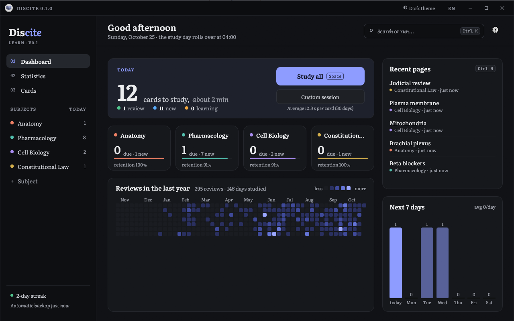
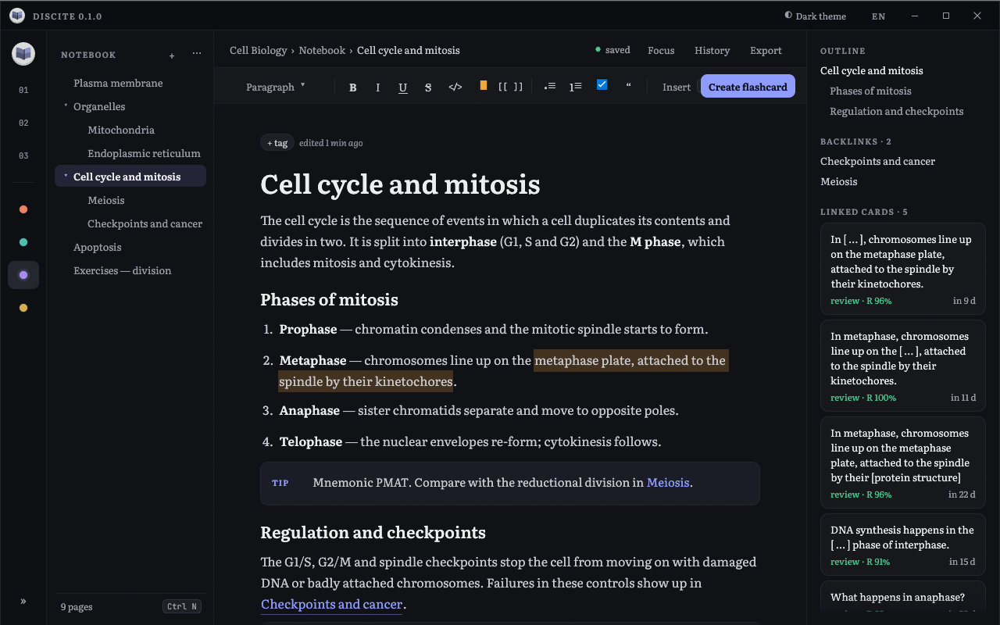
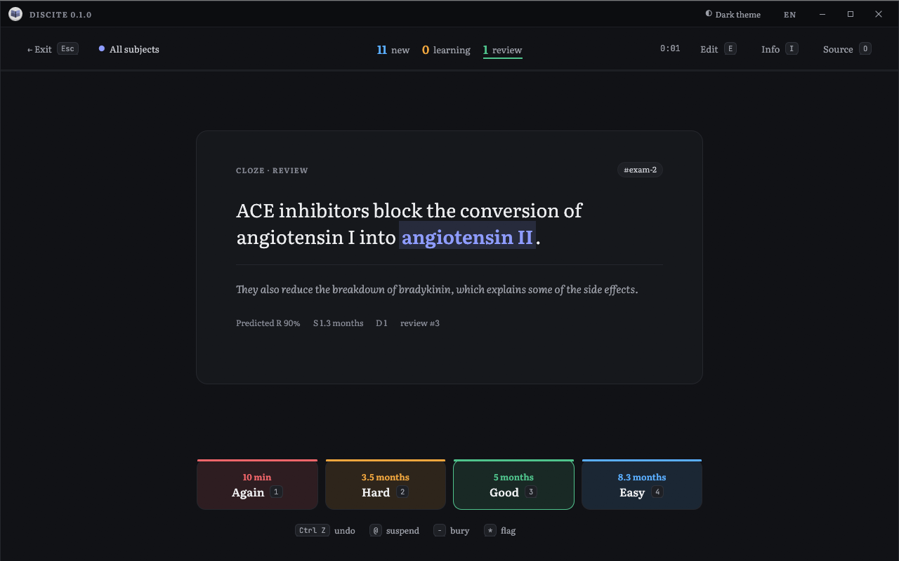
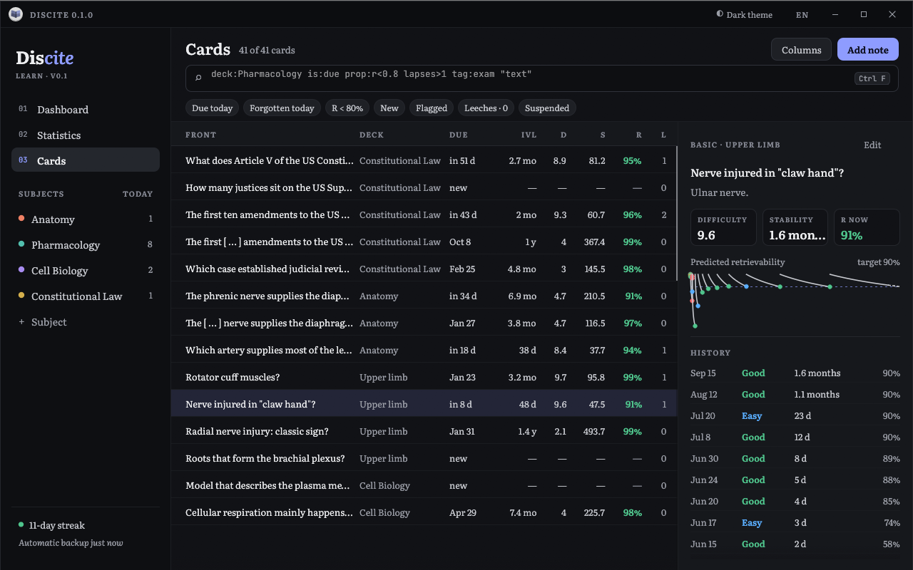
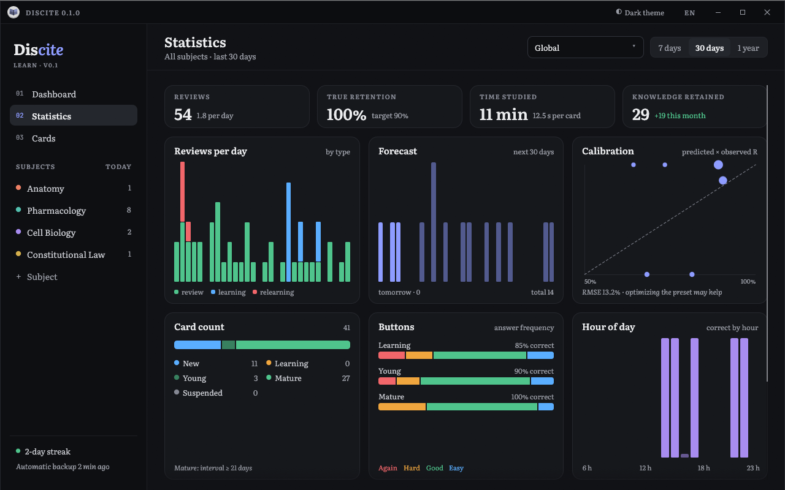
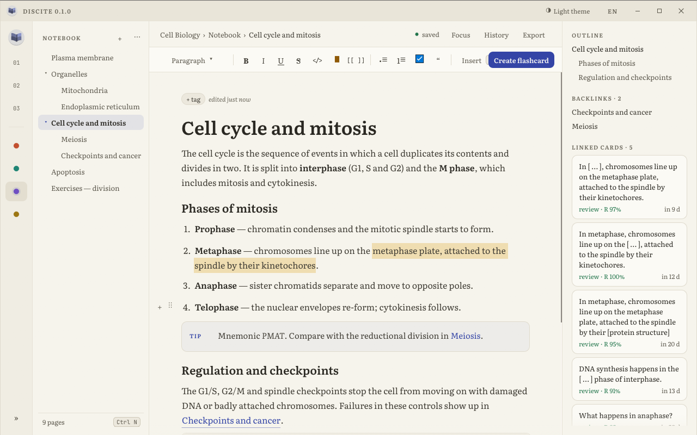
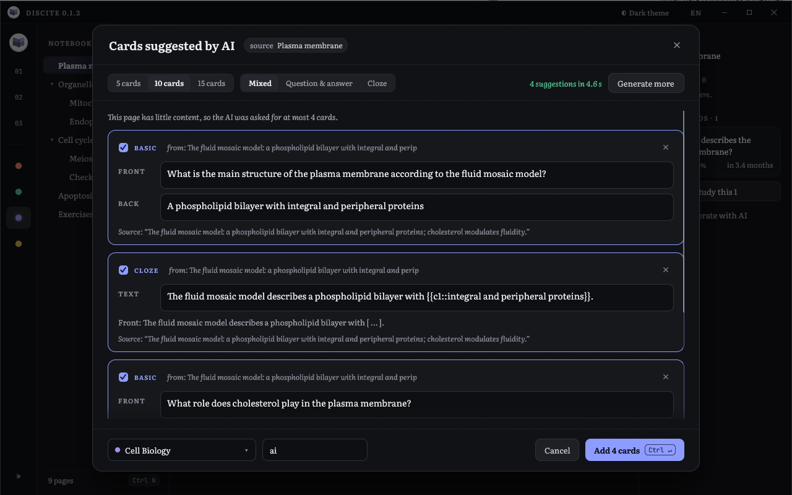
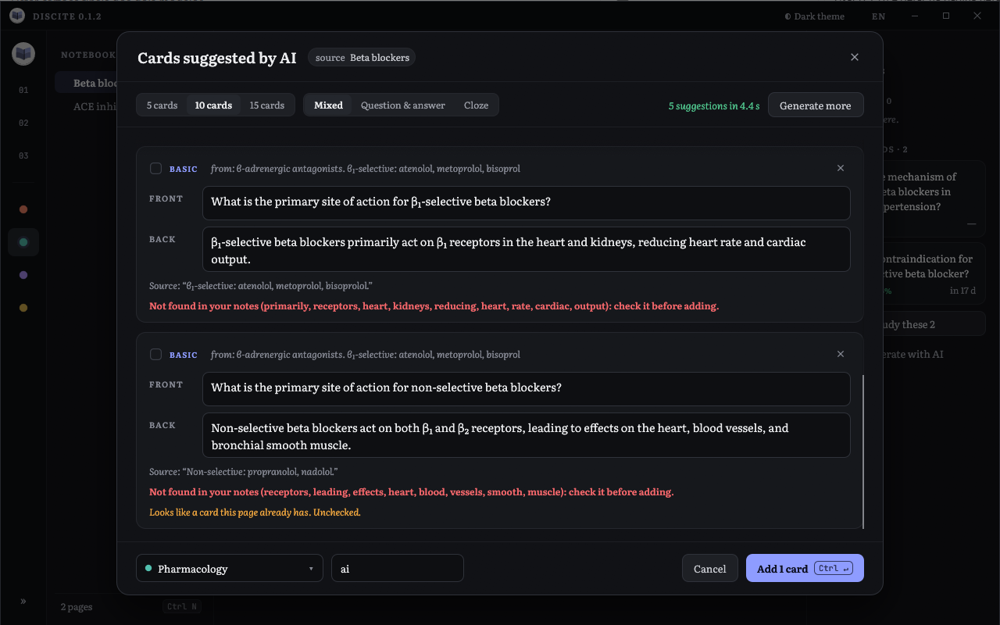
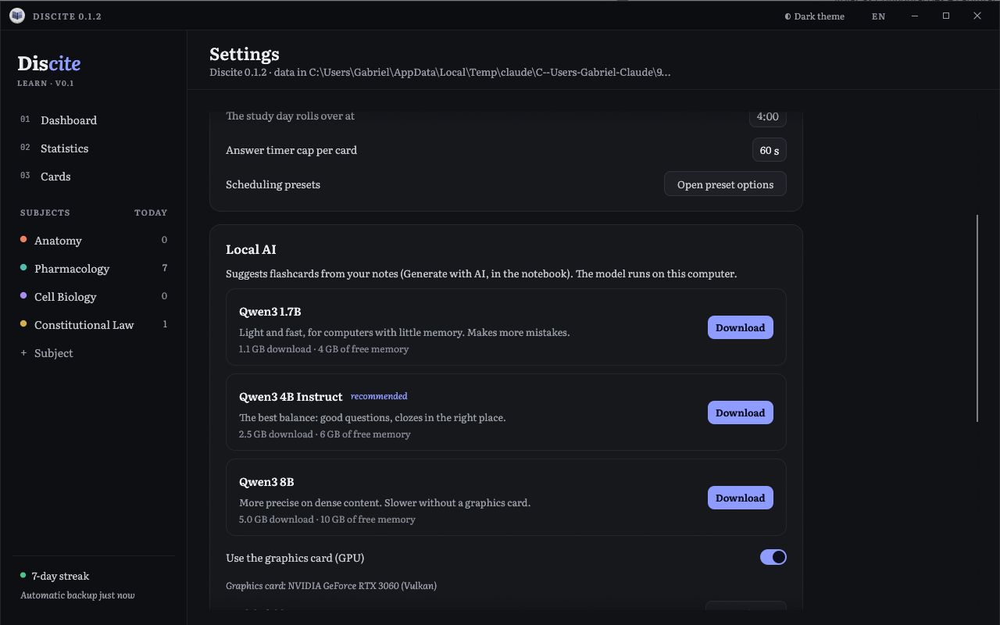

<p align="center">
  
</p>

<h1 align="center">Discite</h1>

<p align="center">
  <strong>A study notebook and spaced-repetition flashcards in one desktop app — written in Rust 🦀</strong><br>
  Take notes, turn them into cards, and let FSRS decide when you see them again.
</p>

<p align="center">
  
  
  
  
  
  
  
</p>

<p align="center">
  <a href="#-features">Features</a> ·
  <a href="#-local-ai">Local AI</a> ·
  <a href="#-how-scheduling-works">How scheduling works</a> ·
  <a href="#-getting-started">Getting started</a> ·
  <a href="#%EF%B8%8F-shortcuts">Shortcuts</a> ·
  <a href="#-releases">Releases</a> ·
  <a href="#-translations">Translations</a> ·
  <a href="#%EF%B8%8F-project-layout">Project layout</a>
</p>

<p align="center">
  
</p>

---

**Discite** (Latin for *"learn!"*) puts the two halves of studying in one place.
You write your notes in a block editor, grouped by subject. You turn any passage
into a flashcard without leaving the page. Every card keeps a link back to the
note it came from, and every answer you give is logged, so the scheduler
learns how *your* memory works. It is a single native executable, and all
your data lives in one SQLite file on your machine.

<table>
  <tr>
    <td></td>
    <td></td>
  </tr>
  <tr>
    <td></td>
    <td></td>
  </tr>
</table>

## ✨ Features

### 📓 Notebook

- **Block editor.** Pages and sub-pages per subject, with paragraphs, headings,
  bulleted, numbered and checklists, quotes, callouts, code, formulas, tables,
  dividers and images.
- **Live markup.** `**bold**`, `*italic*`, `__underline__`, `~~strike~~`,
  `` `code` ``, `==highlight==` and `[[Page links]]` (Ctrl+click follows them).
  Typing `# `, `- `, `1. `, `[] `, `> `, ```` ``` ```` or `---` turns the line
  into that block, and `/` opens the block menu.
- **Images.** Paste with Ctrl+V, drop a file on the window or pick one from
  disk. Each image is copied into Discite's `media` folder, so the note never
  breaks when the original moves. Click an image to zoom in.
- **Autosave**, version history, backlinks, outline, tags, full-text search
  (Ctrl+K), and Markdown import/export.
- **Create flashcard** (Ctrl+Shift+F) from the selected text. The card
  remembers its source page, and the page lists every card made from it.
- **Generate with AI** (Ctrl+Shift+G): a model running on your own computer
  suggests cards from the page, a block or the selected text. You review them
  before anything is added (see [Local AI](#-local-ai)).

### 🗂️ Flashcards

- **Note types.** Basic, Basic + reversed, Cloze (`{{c1::answer::hint}}`,
  Ctrl+Shift+C), Type the answer, and Image occlusion (masks drawn on the image).
- **FSRS-6 scheduling** through the [`fsrs`](https://crates.io/crates/fsrs)
  crate, the same engine Anki uses. It includes:
  - learning and relearning steps;
  - guaranteed Hard < Good < Easy;
  - fuzz and load balancing;
  - daily limits and a configurable day rollover (04:00 by default);
  - buried siblings and leech detection;
  - SM-2 as an alternative.
- **Everything is logged.** Each answer goes to the `revlog` with its grade,
  time, elapsed days, states, D/S before and after, and the predicted R. Undo
  (Ctrl+Z) never deletes a row; it only marks the answer as undone.
- **Presets with an optimizer.** It trains the parameters on your own history
  and shows log loss and RMSE before and after. A simulator shows the workload
  against retention over 365 days.
- **Card browser** with a search language: `deck:`, `subject:`, `tag:`,
  `is:due/new/learn/review/suspended/flagged/leech`, `prop:r<0.8`, `prop:d>7`,
  `lapses>2`, `added:7`, `rated:1:1`, `"text"` and `-negation`. It also has
  bulk actions and a side panel with each card's retrievability curve and history.
- **Custom study.** Forgotten cards, review ahead, recent new cards, low R,
  flagged cards, or any search.

### 📊 Dashboard and statistics

- **A "Today" panel** with the estimated study time, a tile per subject, a
  year-long heatmap, recent pages, and a 7-day forecast.
- **Statistics:**
  - reviews per day by type, a 30-day forecast, and calibration (predicted vs observed R);
  - card count, button frequency, and accuracy by hour;
  - D, S and R distributions;
  - knowledge retained over time.

### 🎨 And also

- A command palette for every action, plus dark and light themes based on a
  Claude Design canvas. Literata and JetBrains Mono fonts are built in.
- On Windows, a custom title bar. On macOS, the native one, with shortcuts
  shown with ⌘.
- English and Brazilian Portuguese are built in. More languages can be added
  as plain XML files (see [Translations](#-translations)).

<p align="center">
  
</p>

## 🤖 Local AI

<p align="center">
  
</p>

Discite can turn your notes into flashcards with an AI that runs **entirely on
your computer**. Your notes are never sent anywhere: [llama.cpp](https://github.com/ggml-org/llama.cpp)
is built into the executable, and the only connection is the one-time model
download from Hugging Face.

- **Where it is.** *Generate with AI* in the page toolbar (or in the *Insert*
  menu on narrow windows), *AI cards from this block* in a block's ⠿ menu,
  the button under *Linked cards*, the command palette, and **Ctrl+Shift+G**.
  With text selected, only that passage is used.
- **You stay in charge.** Suggestions arrive one by one in a review window.
  Each one can be edited, unchecked or discarded, and nothing becomes a card
  until you press *Add*. Choose how many (5, 10, 15), the kind (question and
  answer, cloze, or mixed), the deck and the tags.
- **Wired into the notebook.** Every card keeps a link to its page *and* to the
  block it came from, so it shows up under *Linked cards* right away. Cards
  that repeat ones the page already has come unchecked, with a warning.
- **Always valid.** A grammar forces the model to answer with well-formed cards,
  and clozes the model misplaces (`… a sentence. {{c1::term}}`) are moved back
  onto the term.

### Only what your notes say

Small models sometimes "help" with facts they know but you didn't write. In a
flashcard app that is worse than useless: you would memorize it as if it were
your note. So every suggestion must come with **the passage of your notes that
backs it**, and Discite checks it before showing the card:

- the passage must really be in the page (small differences allowed);
- the answer may only use words that appear in the notes (paraphrase verbs and
  inflections are fine), and every number must match.

A card that fails comes **unchecked**, with a red warning listing the words
that are not in your notes. Each card also shows its source passage. On top
of that, a page with little content is never asked for more cards than it has
facts (padding was the main cause of invented cards), and the model is told
the language of your notes.

<p align="center">
  
</p>

Measured on eight pages (Portuguese and English, short and long), reading every
card against its page:

| | Before the check | With the check |
|---|---|---|
| Qwen3 4B: cards with facts not in the notes | 11 of 78 (14%), none flagged | 2 of 68 (3%), **both flagged** |
| Qwen3 4B: one-sentence pages | 10 invented in 18 | 0 in 8 |
| Qwen3 1.7B: cards with facts not in the notes | ~17 of 68 (25%), none flagged | 6 of 37, **all flagged** |

The check works on words, not meaning: it catches outside facts and swapped
answers ("increase" where the note says "reduce"), but not a wrong link made
only with words from the note. That is why nothing is added without your
review. To rerun the measurement:
`DISCITE_EVAL_MODEL=<model.gguf> DISCITE_EVAL_OUT=<out.jsonl> cargo test --release eval_cards -- --ignored`.

### Models

Pick one in **Settings → Local AI**. It downloads once, can be paused and
resumed, and is checked against its SHA-256 before use. All three are
[Qwen3](https://huggingface.co/Qwen) models under the Apache 2.0 license,
quantized to Q4_K_M by [Unsloth](https://huggingface.co/unsloth).

| Model | Download | Free memory | Notes |
|---|---|---|---|
| Qwen3 1.7B | 1.1 GB | 4 GB | Light and fast; makes more mistakes. |
| **Qwen3 4B Instruct** | 2.5 GB | 6 GB | **Recommended.** Good questions, clozes in the right place. |
| Qwen3 8B | 5.0 GB | 10 GB | More precise on dense content; slow without a GPU. |

<p align="center">
  
</p>

### Speed

The AI uses the graphics card when there is one: **Vulkan** on Windows (any
recent NVIDIA, AMD or Intel GPU, through the driver you already have) and
**Metal** on Apple Silicon Macs. Otherwise it runs on the processor. With the
recommended model, ten cards from a typical page take:

| Hardware | Time |
|---|---|
| NVIDIA RTX 3060 (Vulkan) | ~12 s |
| Ryzen 5 5600GT, processor only | ~1–1.5 min (estimated from ~10 tokens/s) |

The first generation after opening Discite also loads the model (a few seconds,
a bit longer the first time the GPU sees it). The model leaves memory after
five idle minutes.

## 🧠 How scheduling works

FSRS models each card with three numbers:

| | Meaning |
|---|---|
| **D**: difficulty | How hard the card is for you, from 1 to 10. |
| **S**: stability | How many days it takes for the chance of remembering it to fall to 90%. |
| **R**: retrievability | The chance you remember it *right now*. It decays with time following a power curve. |

Each answer (Again, Hard, Good, Easy) updates D and S. The next review is
scheduled for the day R is expected to reach your **desired retention**
(90% by default). The buttons show that interval before you press them.
A higher target means more reviews and better recall. The simulator in each
preset shows the trade-off before you change it.

Because every answer is logged with the R that was predicted for it, Discite
can check itself. The calibration chart compares predicted and observed recall.
The optimizer fits the 21 FSRS parameters to your history and shows how well the
old and new ones predict it before you apply them.

## 🚀 Getting started

You need [Rust](https://rustup.rs) (stable, edition 2024) and, to build the
embedded llama.cpp, [CMake](https://cmake.org) and libclang
([LLVM](https://releases.llvm.org)).

- **Windows:** the Visual Studio Build Tools with the C++ workload, LLVM
  (set `LIBCLANG_PATH` to its `bin` folder if bindgen can't find it) and the
  [Vulkan SDK](https://vulkan.lunarg.com/sdk/home), used only to compile the GPU
  shaders.
- **macOS:** the Xcode command line tools and CMake (`brew install cmake`).

```bash
git clone https://github.com/dazevedogabriel/Discite.git discite
cd discite
cargo build --release
```

Run `target/release/discite.exe` (Windows) or `target/release/discite` (macOS).
It needs nothing installed next to it.

> **Windows and long paths.** Compiling the Vulkan shaders creates very deep
> folders. If the build fails with `C1083` or "file name too long", build into
> a short folder: `set CARGO_TARGET_DIR=C:\t` (the GitHub workflow does this).

- **Your data** lives in `%APPDATA%\Discite` on Windows and in
  `~/Library/Application Support/Discite` on macOS. It holds `discite.db`
  (SQLite), `media/` with the images, `backups/` with automatic backups and
  `models/` with the AI models you downloaded.
  To try things without touching your data, point the `DISCITE_DATA`
  environment variable at another folder.
- **Sample content.** On an empty database, the dashboard offers to load an
  example: four subjects with pages, decks, notes and a simulated year of reviews
  (the screenshots above). With `DISCITE_DEMO=1` it loads at startup.
- **Tests:** `cargo test`.

## ⌨️ Shortcuts

On macOS, Ctrl is ⌘.

| Where | Key | Action |
|---|---|---|
| Anywhere | Ctrl K | Command palette |
| Anywhere | Ctrl N | New page |
| Anywhere | Ctrl Shift A | Add note |
| Anywhere | Ctrl \\ | Collapse/expand the sidebar |
| Anywhere | Ctrl F | Search cards |
| Dashboard | Space | Study all |
| Review | Space / Enter | Show answer, then Good |
| Review | 1 2 3 4 | Again, Hard, Good, Easy |
| Review | Ctrl Z | Undo |
| Review | E / I / O | Edit, Info, Source |
| Review | @ / - / * | Suspend, Bury, Flag |
| Notebook | Ctrl B / I / U / E | Bold, italic, underline, code |
| Notebook | Ctrl Shift H | Highlight |
| Notebook | Ctrl Shift F | Create flashcard from selection |
| Notebook | Ctrl Shift G | Generate cards with AI (selection or page) |
| Notebook | Tab / Shift Tab | Indent / outdent list item |
| Note editor | Ctrl Enter | Add or save |

## 📦 Releases

Two GitHub Actions workflows build the app for both platforms:

- **[`build.yml`](.github/workflows/build.yml)** builds and tests on Windows x64
  and macOS universal (Apple Silicon + Intel, macOS 10.15 or newer). It runs on
  every push to `main`, on pull requests, and on demand (*Actions → Build → Run
  workflow*). The packages are attached to the run:
  - `Discite-<version>-windows-x64.zip` with `Discite.exe`;
  - `Discite-<version>-macos-universal.zip` with `Discite.app`.
- **[`release.yml`](.github/workflows/release.yml)** publishes a GitHub release
  with both packages when a `v*` tag is pushed. The tag must match `version` in
  `Cargo.toml`:

  ```bash
  git tag v0.1.0
  git push origin v0.1.0
  ```

### Opening the macOS app

The `.app` only has an ad-hoc signature (no Apple developer account), so macOS
blocks the first launch:

- **macOS 14 or older:** right-click the app → **Open**.
- **macOS 15 or newer:** try to open it, then go to **System Settings → Privacy
  & Security → Open Anyway**.
- **"The app is damaged":** run `xattr -dr com.apple.quarantine /Applications/Discite.app`.

## 🌍 Translations

Every text Discite shows comes from [`locales/`](locales). **English** and
**Português (Brasil)** ship inside the executable. English is the default. Switch
with the language button in the title bar (**EN**) or in **Settings → Appearance
→ Language**. *Automatic* follows the system language. The change applies at once.

Adding a language takes no compiler:

1. Copy [`locales/en.xml`](locales/en.xml) and change `code` and `name`:
   ```xml
   <language code="es" name="Español">
     <string key="review.show_answer">Mostrar respuesta</string>
     <plural key="time.months_ago"><one>hace {n} mes</one><other>hace {n} meses</other></plural>
   </language>
   ```
2. Translate the text between the tags. Keep each `key` and every
   `{placeholder}`. A `<plural>` takes `<one>` (for 1) and `<other>`.
   `format.decimal` and `format.thousands` set the number separators.
3. Save it as `es.xml` in the `locales` folder inside the data folder
   (`%APPDATA%\Discite\locales\` or `~/Library/Application Support/Discite/locales/`),
   or in a `locales` folder next to the executable. Reopen Discite, and the
   language shows up in the menu.

Missing keys fall back to English, then to Portuguese, so a partial translation
still works. A file with the code of a built-in language overrides just the keys
it has. To ship a language inside the executable, add the file to `locales/`
and to `BUILT_IN` in [`src/i18n.rs`](src/i18n.rs). `cargo test` then checks
that it has every key the code uses.

## 🗂️ Project layout

```text
discite/
├── src/
│   ├── main.rs        entry point
│   ├── srs.rs         pure scheduler: FSRS, learning steps, fuzz, SM-2 (with tests)
│   ├── db.rs          SQLite schema, migrations and queries
│   ├── cards.rs       note types, cloze, occlusion masks, typed-answer diff
│   ├── rich.rs        inline markup
│   ├── search.rs      card search language → SQL
│   ├── stats.rs       statistics
│   ├── media.rs       image storage
│   ├── i18n.rs        translations loaded from locales/*.xml
│   ├── ai/            local AI: llama.cpp engine, models and download, prompt, grammar, grounding check
│   └── gui/           one file per screen, plus theme.rs (design tokens) and widgets.rs
├── locales/           en.xml and pt-BR.xml: every text the app shows
├── assets/            logo.svg (also the app icon) and fonts
├── packaging/macos/   Info.plist for Discite.app
├── docs/images/       screenshots
├── .github/workflows/ build and release
├── build.rs           turns assets/logo.svg into the Windows .ico and the macOS .icns
└── SPEC.md            the original specification
```

Want a different icon? Replace `assets/logo.svg` and rebuild. The executable,
window and app icons are generated from it.

## 🙏 Credits

- [Literata](https://github.com/googlefonts/literata) by TypeTogether and
  [JetBrains Mono](https://www.jetbrains.com/lp/mono/) by JetBrains, both under
  the SIL Open Font License.
- Scheduling by [fsrs-rs](https://github.com/open-spaced-repetition/fsrs-rs),
  from the [Open Spaced Repetition](https://github.com/open-spaced-repetition)
  project.
- Built on [egui/eframe](https://github.com/emilk/egui),
  [rusqlite](https://github.com/rusqlite/rusqlite),
  [resvg](https://github.com/linebender/resvg) and
  [roxmltree](https://github.com/RazrFalcon/roxmltree).
- Local AI by [llama.cpp](https://github.com/ggml-org/llama.cpp) (MIT), through
  [llama-cpp-rs](https://github.com/utilityai/llama-cpp-rs), with
  [Qwen3](https://huggingface.co/Qwen) models (Apache 2.0) quantized by
  [Unsloth](https://huggingface.co/unsloth).
- Inspired by [Anki](https://apps.ankiweb.net). Discite is an independent
  project, not affiliated with Anki.

<p align="center"><sub>Made with 🦀 and a lot of reviews rated <em>Good</em>.</sub></p>
